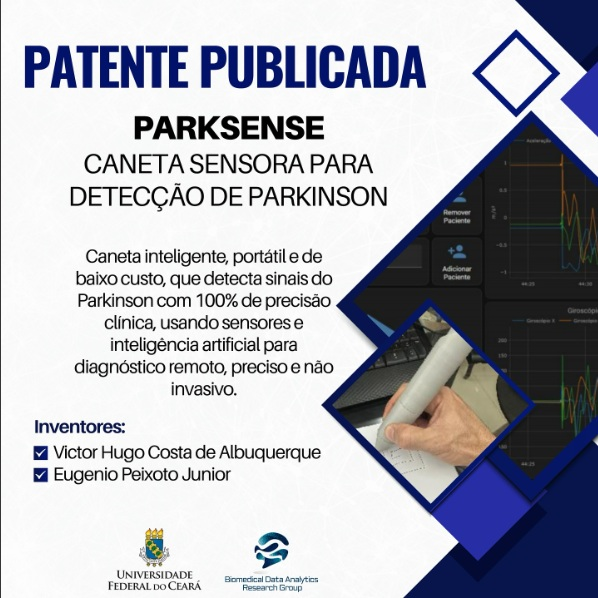

# Patente Publicada: PARKSENSE 
Caneta Inteligente para Detecção de Parkinson com 100% de precisão clínica

Número da patente: BR 10 2025 011637 5

Os pesquisadores Victor Hugo C. de Albuquerque e Eugenio Peixoto Junior patentearam a invenção ParkSense, caneta inteligente capaz de detectar sinais da Doença de Parkinson com elevada precisão.
O produto é fruto da inovação, ciência de ponta e compromisso do BioDatA com o desenvolvimento de soluções tecnologicas inovadoras para a saúde

### 1. PATENTE - Caneta Sensora para detecção de Parkinson
- [PARKSENSE](https://www.instagram.com/p/DLYOzRfyLw0/?cnvx=MTFjY3YwNmwyMDZuNw%3D%3D)

### 2. BioData - Biomedical Data Analytics Research Group
- [BioData](https://www.instagram.com/_biodata_?dmpr=Ym40b2xobzVyYWxp)

# Inteligência Artificial Aplicada na área da saúde (Parkinson)

## Artigos Científicos - Entre na pasta "Artigos" para mais detalhes.

### 1. Multimodal diagnosis of Parkinson’s disease with an internet-based collaborative agent architecture of medical language models
- [Computers in Biology and Medicine - Elsevier](https://doi.org/10.1016/j.compbiomed.2026.111468)
- https://doi.org/10.1016/j.compbiomed.2026.111468
- **Ano:** 2026
### 2. Intelligent Sensory Pen for Aiding in the Diagnosis of Parkinson’s Disease from Dynamic Handwriting Analysis
- [Sensors - MDPI](https://doi.org/10.3390/s20205840)
- https://doi.org/10.3390/s20205840
- **Ano:** 2020

